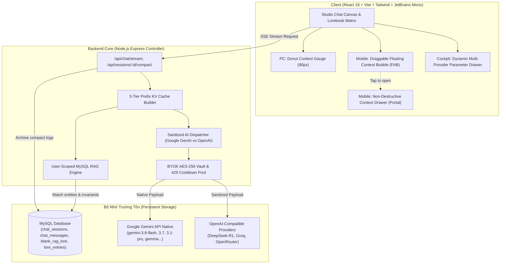

# 🌌 INTPcrafter // StoryContainer Engine

<p align="center">
  
  
  
  
  
</p>

> **"Tôi không bị điên, tôi chỉ đang mô phỏng lại một thực tại khác mà ở đó logic thế giới không bao giờ sụp đổ."**  
> — *Một dev INTP 5w4 lúc 3h47 sáng sau khi nốc 2 lon Monster Energy và nhận ra con AI quên mất nhân vật chính đã chết từ 5 chap trước.*

---

## 🍵 Lời Tự Thú Đầu Tiên Của Kẻ Sáng Thế (INTP 5w4 Confession)

Chào anh em đồng đạo nghiện overthinking, tôi là cái thằng thức trắng đêm code ra cái của nợ này đây.

Nói thật lòng thì cái repo này sinh ra **chỉ để thỏa mãn cơn ảo tưởng vĩ đại và bệnh hoạn của bản thân**. Là một thằng INTP 5w4 chính hiệu, tôi mắc chứng bệnh nan y mang tên: *nghiện xây dựng thế giới (worldbuilding) và dị ứng cực độ với sự thiếu logic*.

Anh em có bao giờ cay cú cái cảm giác này chưa:
- Viết truyện tiên hiệp / sci-fi đến chap 15, con AI tự nhiên cho nhân vật chính mọc thêm cánh tay thứ ba dù ở chap 1 nó bị chặt cụt tay trái?
- Thế giới ma pháp quy định rõ ràng *"Dùng thần chú cấp 5 sẽ bị nổ đứt kinh mạch"*, nhưng 3 chap sau AI cho con creep qua đường bắn thần chú cấp 8 như súng liên thanh mà không trầy một cọng lông?
- Prompt dài được 20 lượt chat thì AI bắt đầu lú mề, nói nhảm, hallucination ngập mồm và token bay màu như tiền lương ngày nhận thưởng?

Thế là tôi đập bàn, đeo tai nghe bật Synthwave 10 tiếng, nhai mì tôm sống và quyết định tự code ra **INTPcrafter** (tên mã dự án: **StoryContainer Engine**). Một cỗ máy giả lập tiểu thuyết kết hợp giữa sự thực dụng tàn nhẫn của **Novelcrafter**, linh hồn của **Google AI Studio**, buồng lái tham số sâu của **LibreChat**, và sự cố chấp bảo toàn nhân quả luận của một gã INTP!

---

## ⚡ Các Tính Năng "Ảo Tưởng Siêu Cấp" Có Một Không Hai

Dưới đây là danh sách những thứ quái đản mà tôi đã nhồi nhét vào để phục vụ cho sự sung sướng của não bộ:

### 1. 🧬 Kiến Trúc 3-Tier Prefix KV Cache (Bảo Tồn Ký Ức & Cứu Rỗi Ví Tiền)
Đây là đỉnh cao của sự overthinking. Để AI không bị lú lẫn mà vẫn tận dụng được bộ nhớ đệm KV Cache của Google GenAI:
- **Tier 1 (Bất Biến Tuyệt Đối - Max 40k Tokens)**: 
  - Khắc ghi System Prompt toàn cục, định luật ma pháp, thế giới quan và tính cách cốt lõi của nhân vật chính.
  - **Quy tắc vàng**: Bất biến 100% từng byte (`Byte-Identical`). Trời có sập, sấm sét có đánh thì Tier 1 cũng không được lệch dù chỉ một dấu phẩy, giúp kích hoạt cơ chế Cache Prefix của Google để giảm giá 50% tiền API và tăng tốc độ phản hồi bàn thờ!
- **Tier 2 (Thay Đổi 1 Ít - Semi-Static Arc Anchor)**: 
  - Địa danh hiện tại (Arc Location), danh sách NPC tham chiến trong phân đoạn, trạng thái thế giới đương thời.
- **Tier 3 (Lịch Sử Hội Thoại Cuộn & Transient RAG)**: 
  - Nhật ký của Đấng Sáng Thế + Lore động trích xuất theo thời gian thực + các lượt chat đối thoại tuần tự.

### 2. 📜 Blank RAG Lore - "Sổ Nhật Ký Bí Mật Của Kẻ Sáng Thế" (`Ctrl + J`)
- Thay vì để AI tự do chém gió rồi tự quên, tính năng **Blank RAG Lore** cho phép bạn tự gõ nhật ký biên niên sử thế giới (Chronicle Journal).
- Nhấn phím tắt thần thánh `Ctrl + J` (hoặc `Cmd + J`) bất kỳ lúc nào để triệu hồi cuốn sổ da ghi chép.
- Khi cần, bấm một phát nút **⚡ Compact History**, hệ thống sẽ tự động tóm tắt 20 chap cũ, nén thành các gạch đầu dòng cô đọng và nhét thẳng vào cuốn sổ nhật ký này, rồi quét sạch tin nhắn rác khỏi DB để giải phóng RAM cho não AI!

### 3. 🫧 Bong Bóng Mobile Context Kéo Đi Kéo Lại Được (Floating Draggable FAB)
- Trên điện thoại (màn hình nhỏ như Samsung Galaxy 360px), cái thanh dock chat chật như xe buýt giờ cao điểm. Nhét thêm nút vào là văng khung hình ngay.
- Tôi giải quyết bằng cách: Chế ra một **Bong Bóng Context Thần Thánh** lơ lửng trên màn hình (`createPortal` gắn thẳng vào `document.body`):
  - **"Kéo đi kéo lại được"**: Anh em có thể lấy ngón tay nắm đầu bong bóng kéo đi khắp bốn phương tám hướng trên màn hình như bong bóng chat của Facebook Messenger để nghịch lúc đợi AI vắt óc sinh chữ!
  - **Tự động bắt mép (Edge Snapping)**: Thả tay ra một cái là bong bóng tự bay dính vào mép màn hình cực mượt.
  - **Đèn báo động lực học Cyberpunk**:
    - Dưới 65% dung lượng: Xanh Cyan rực rỡ (`#00f0ff`) — *"Tâm bất biến giữa dòng đời vạn biến"*.
    - 65% - 85%: Vàng Amber cảnh báo (`#f59e0b`) — *"Liệu hồn đấy, sắp lú rồi"*.
    - Trên 85%: Đỏ Rose nguy hiểm (`#f43f5e`) — *"Báo động đỏ! Nén ngay kẻo cháy túi!"*.
  - **Chạm nhẹ là mở Bottom Sheet**: Không làm giật, không làm xô lệch textarea hay thanh dock một milimet nào (`Zero Layout Shift`). Có slider chỉnh trần Context và nút nén sử thi tức thì!

### 4. 🍩 Bàn Thờ Đo Token Trên PC (`DonutContextGauge`)
- Trên PC thì không gian bao la bát ngát, việc gì phải giấu? 
- Giữ nguyên chiếc đồng hồ đo Donut Neon 80px Cyberpunk uy nghi chễm chệ bên cạnh ô chat. Vòng hào quang phát sáng theo nhịp tim, vạch chỉ ngưỡng trượt Rolling Threshold sắc nét như radar quân sự.

### 5. 🎛️ Buồng Lái Tham Số Đa Model (Multi-Provider Cockpit)
- Lấy cảm hứng từ LibreChat, buồng lái tham số cho phép tinh chỉnh sâu từng milimet.
- **Bộ lọc chống rò rỉ tham số (Zero Parameter Leaks)**: Khắc tinh của lỗi `400 Bad Request`.
  - Không bao giờ để rò rỉ tham số độc quyền OpenAI (`frequency_penalty`, `presence_penalty`, `reasoning_effort`) sang endpoint của Google GenAI.
  - Không bao giờ vứt `topK`, `thinkingLevel`, `groundingWithGoogleSearch` sang DeepSeek hay OpenAI.
  - Nhận thức phiên bản thông minh: Tự động phân biệt giữa **Gemini 2.5** (chỉnh `thinkingBudget` theo số lượng token) và **Gemini 3.x** (chỉnh `thinkingLevel`: low, medium, high, auto).

### 6. 🔑 BYOK Vault - "Hồn Ai Nấy Giữ, Key Ai Nấy Tiêu" (Zero-Shared-Key)
- Server này là server vô sản, không bao nuôi API Key miễn phí cho anh em cày cuốc ngày đêm đâu.
- Mỗi người dùng tự quản lý kho chứa key riêng (BYOK). Hỗ trợ nạp 1 đến 10 API Key Gemini.
- Mã hóa kép **SHA-256 (chống trùng lặp) + AES-256-CBC** trước khi lưu vào MySQL.
- Tự động luân chuyển Round-Robin, gặp quả tạ `429 Too Many Requests` là tự động đưa key đó vào diện cách ly 60 giây và kích hoạt key dự phòng ngay lập tức.

### 7. 💅 Giao Diện "Chữa Lành Cận Thị" & JetBrains Mono 100%
- Toàn bộ app từ tiêu đề, nội dung chat, bong bóng, slider đến từng dòng log đều là **JetBrains Mono**. Tôi dị ứng với font chữ uốn éo bo tròn của mấy ông designer. Viết code hay viết truyện thì chữ nó phải vuông vức, nghiêm túc và đậm mùi hacker!
- Chế độ **Zen Mode (`Ctrl + \`)**: Ẩn sạch mọi công cụ vướng mắt, chỉ còn lại bạn, màn đêm đen tuyền (`#020617`) và dòng suy tưởng tuôn trào.

### 8. 📐 Toán Học & Vật Lý Trong Tiểu Thuyết (KaTeX LaTeX Render)
- Đã là INTP viết truyện thì nhân vật chưởng một phát cũng phải giải thích bằng cơ học lượng tử hoặc phương trình sóng vi phân.
- Hỗ trợ gõ công thức Toán - Lý trực tiếp bằng KaTeX: gõ `$E = mc^2$` hay `$$\nabla \times \mathbf{E} = -\frac{\partial \mathbf{B}}{\partial t}$$` là render lung linh như tài liệu nghiên cứu NASA.

---

## 🏛️ Sơ Đồ Kiến Trúc Hệ Thống (INTP Neuro-Matrix)



---

## 🚀 Danh Sách Mô Hình Hỗ Trợ Đỉnh Cao

Hệ thống được thiết kế riêng cho các dòng model tư duy và tốc độ cao hiện nay:

| Tên Model | Cửa Sổ Ngữ Cảnh (Context) | Loại Suy Luận (Reasoning) | Đặc Tính Nổi Bật |
| :--- | :--- | :--- | :--- |
| `gemini-3.8-flash` | 1,048,576 tokens | `google-level` (auto/low/med/high) | Tốc độ bàn thờ, suy nghĩ thần tốc (Mặc định khuyên dùng) |
| `gemini-3.7-flash` | 1,048,576 tokens | `google-level` | Cân bằng hoàn hảo giữa chiều sâu triết học và tốc độ gõ |
| `gemini-3.6-flash` | 1,048,576 tokens | `google-level` | Dự phòng tác chiến khi 3.8 bị nghẽn mạng |
| `gemini-3.1-pro` | 2,097,152 tokens | `google-level` | Quái vật 2 triệu token, nuốt trọn cả bộ tiểu thuyết dài tập |
| `gemini-2.5-pro` | 2,097,152 tokens | `google-budget` (0 - 65535 tokens) | Dàn ý nhiều tầng, tư duy chi tiết đến từng chân tơ kẽ tóc |
| `gemini-2.5-flash` | 1,048,576 tokens | `google-budget` | Trâu bò, bền bỉ, tiết kiệm quota |
| `gemma-4-31b-it` | 131,072 tokens | `none` | Mã nguồn mở mãnh liệt, văn phong tự nhiên không kiểm duyệt |
| `deepseek-r1` | 131,072 tokens | `openai-effort` (auto/low/med/high) | Bộ óc suy luận chuỗi tư duy (CoT) khét lẹt của anh pháp sư Trung Hoa |

*(Mấy con Gemini 1.5 đồ cổ đã bị Google đem đi chôn cất rồi, ở đây chúng tôi không xài đồ viện bảo tàng).*

---

## ⌨️ Bảng Phím Tắt Của Đấng Sáng Thế

| Phím Tắt | Hành Động | Ghi Chú |
| :--- | :--- | :--- |
| `Ctrl + J` / `Cmd + J` | Mở **Chronicle Journal** (Blank RAG Lore) | Cuốn sổ da ghi chép sử thi bí mật |
| `Ctrl + K` / `Cmd + K` | Chuyển đổi giữa **Studio Chat** và **Lorebook Matrix** | Lật qua lật lại giữa viết truyện và nạp lore |
| `Ctrl + \` / `Cmd + \` | Bật / Tắt **Zen Mode** | Ẩn toàn bộ nút bấm để tĩnh tâm gõ chữ |
| `Enter` (Desktop) | Gửi lượt chat | Trên mobile Enter sẽ xuống dòng bình thường |
| `Shift + Enter` | Xuống dòng | Viết văn đoạn dài |

---

## 🛠️ Hướng Dẫn Cài Đặt (Cho Kẻ Nào Cũng Rảnh Giống Tôi)

### 1. Kéo mã nguồn về máy:
```bash
git clone https://github.com/PhucERRscrtcodebruhh/INTPcrafter.git
cd INTPcrafter
```

### 2. Cài đặt các gói phụ thuộc:
```bash
npm install
```

### 3. Cấu hình biến môi trường (`.env`):
Tạo file `.env` ở thư mục gốc:
```env
PORT=3000
DB_HOST=localhost
DB_USER=root
DB_PASSWORD=your_mysql_password
DB_NAME=intpcrafter
JWT_SECRET=sieu_bi_mat_khong_cho_ai_biet_dau_nhe_123456
CRYPTO_SECRET=khoa_aes_256_dung_32_ky_tu_ngau_nhien!!
```

### 4. Khởi tạo cơ sở dữ liệu:
```bash
npm run seed
```

### 5. Chạy toàn bộ bài test kiểm tra độ tỉnh táo (Sanity & 3-Tier KV Cache Tests):
```bash
npm test
```
*(Nếu hiện 100% dòng xanh lá cây PASS là bạn đã đủ điều kiện gia nhập hội overthinking).*

### 6. Khởi động cỗ máy giả lập thực tại:
```bash
npm run dev
```
- Mở trình duyệt truy cập: `http://localhost:5173`
- Đăng nhập tài khoản test: ID `0` (hoặc `dev`), mật khẩu: `0000` (hoặc đăng ký tài khoản mới toanh cho riêng mình).
- Nạp API Key Gemini vào Vault và bắt đầu sáng tạo vũ trụ!

---

## ⚖️ Giấy Phép Sử Dụng (License)

Dự án này được phát hành dưới giấy phép **GNU Affero General Public License v3.0 (AGPL-3.0)**.

> **Tóm tắt tinh thần AGPL-3.0 theo ngôn ngữ loài người:**  
> Mã nguồn này hoàn toàn miễn phí và mở cho cộng đồng những người đam mê viết lách và công nghệ AI. Bạn có quyền đọc, sửa, chạy, chế cháo thoải mái. **NHƯNG** nếu bạn dám lấy mã nguồn này về sửa lại rồi dựng web server đem đi kinh doanh thu tiền hoặc bán khóa học lùa gà mà KHÔNG công khai toàn bộ mã nguồn cải tiến theo giấy phép AGPL-3.0, thì luật nhân quả (và cộng đồng mã nguồn mở) sẽ trừng phạt bạn!

Xem toàn văn giấy phép tại file [`LICENSE`](file:///d:/INTPcrafter/LICENSE).

---

## 📜 Lời Kết Từ Tận Đáy Não

Cuộc đời thực tại đầy rẫy những biến số hỗn loạn, phi lý và những kẻ không chịu suy nghĩ logic. Nếu bạn không thể thay đổi được thế giới thực, hãy tự tay gõ code tạo ra một vũ trụ của riêng mình — nơi ma pháp tuân theo định luật bảo toàn, nhân quả không bao giờ đứt gãy, và mỗi token tuôn ra đều là một hạt cát kiến tạo nên kỳ quan.

Chúc anh em thẩm du tư tưởng vui vẻ với **INTPcrafter**! ⭐ Đừng quên thả **1 Star trên GitHub** để tôi biết mình không phải là kẻ hoang tưởng duy nhất còn sống sót giữa vũ trụ này!
